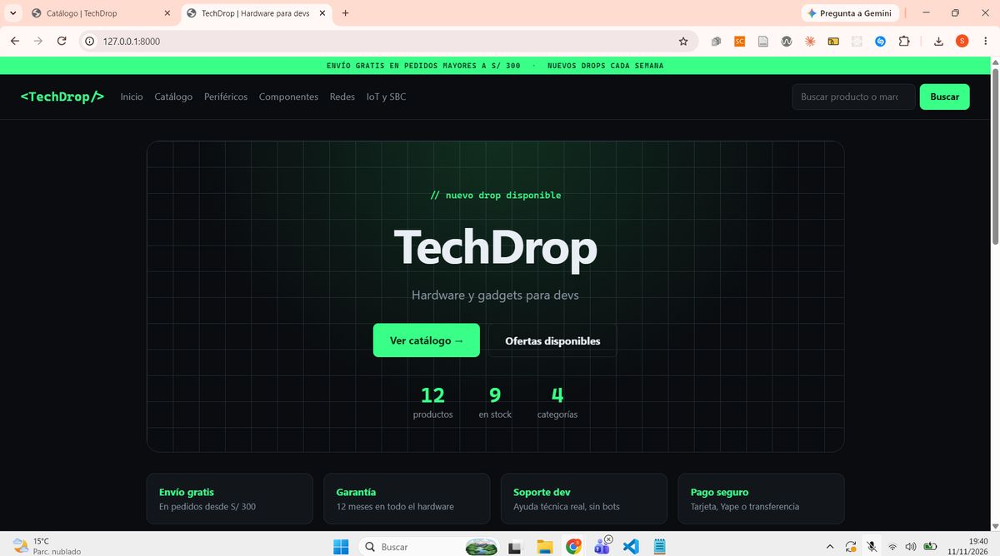
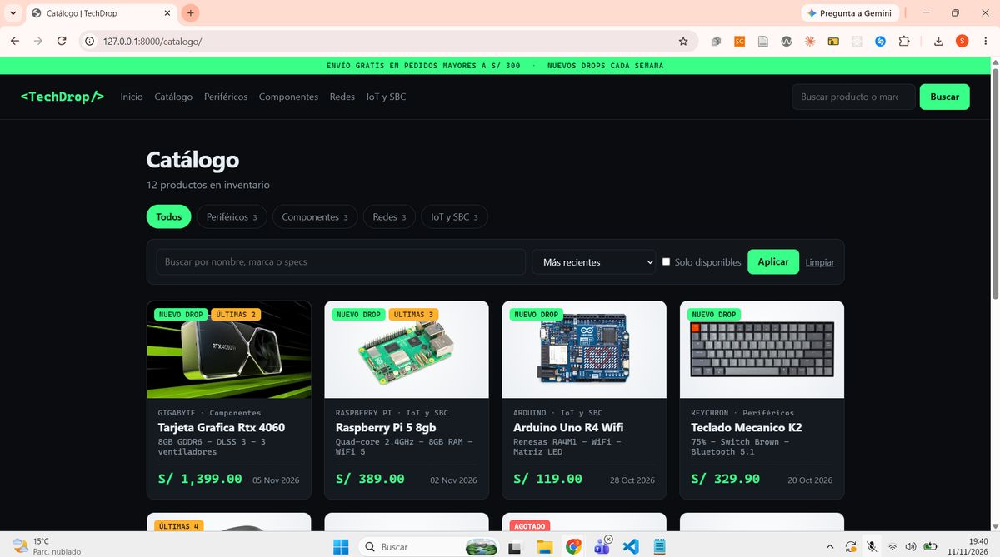
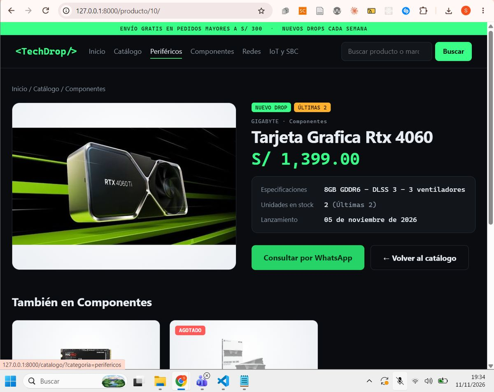
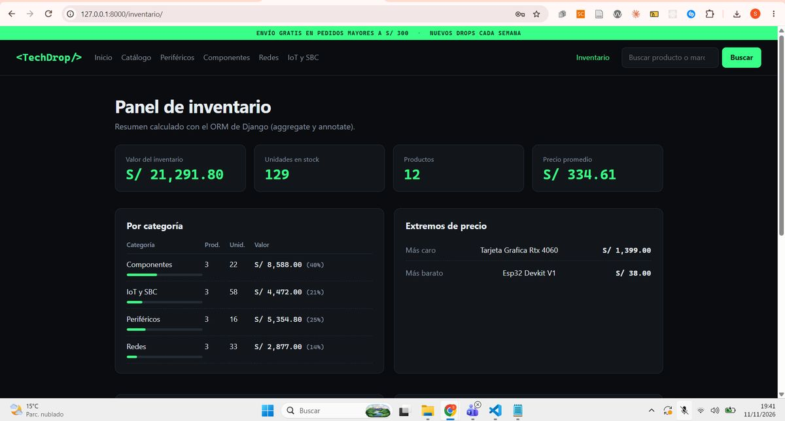

<div align="center">

# &lt;TechDrop/&gt;

**Catálogo e inventario de hardware y gadgets para desarrolladores**


Práctica Semana 11 · Desarrollo de Aplicaciones Web (IS093A) · Ingeniería de Sistemas, UNCP

[Ver página del proyecto](https://stevenhuamanlazo.github.io/DAW_PRACTICA_SEM11_TechDrop/)

</div>

Aplicación web hecha con **Django 5.2** y **SQLite** que aplica el patrón **MTV** (Model-Template-View): catálogo de teclados, componentes, redes y placas IoT, con control de stock, filtros, búsqueda, paginación, ficha de producto y un panel de inventario solo para el personal.

> GitHub Pages solo sirve contenido estático, por eso la página del proyecto muestra capturas. La aplicación Django se ejecuta en local (ver abajo).

## Vista previa

| Inicio | Catálogo |
|---|---|
|  |  |
| **Ficha de producto** | **Panel de inventario (staff)** |
|  |  |

## Cómo ejecutarlo (Windows / PowerShell)

```powershell
git clone https://github.com/stevenhuamanlazo/DAW_PRACTICA_SEM11_TechDrop.git
cd DAW_PRACTICA_SEM11_TechDrop
python -m venv venv
venv\Scripts\Activate.ps1
pip install -r requirements.txt
python manage.py check
python manage.py migrate
python manage.py cargar_datos
python manage.py createsuperuser
python manage.py runserver
```

Abrir <http://127.0.0.1:8000/>. La base `db.sqlite3` no se sube al repositorio, por eso se genera con `migrate` y se llena con `cargar_datos` (usa el ORM y se puede repetir sin duplicar datos).

Pruebas automáticas: `python manage.py test`

## Rutas

| URL | Vista | name |
|---|---|---|
| `/` | `home` (FBV) | `tienda:home` |
| `/catalogo/` | `CatalogoView` (CBV, `ListView`) | `tienda:catalogo` |
| `/producto/<id>/` | `DetalleView` (CBV, `DetailView`) | `tienda:detalle` |
| `/inventario/` | `InventarioView` (CBV, `TemplateView`), **solo personal (staff)** | `tienda:inventario` |
| `/admin/` | Admin de Django | |

El catálogo acepta `?categoria=`, `?q=`, `?orden=`, `?disponibles=1` y `?page=` (8 productos por página).

## Qué se aplica de la guía

- **Rutas:** `config/urls.py` incluye `tienda/urls.py` con `include()`; todas con `name` y en las plantillas solo se usa ``.
- **Vistas:** una FBV (`home`) y CBV (`ListView`, `DetailView`) con `get_context_data()`. Sin lógica de negocio: el filtrado vive en el QuerySet del modelo.
- **Plantillas:** `base.html` con bloques; `catalogo.html`, `home.html` y `detalle.html` con ``, ``/``, ``/``, `` y filtros (`title`, `date`, `upper`, `truncatechars`, `floatformat`, `pluralize`).
- **Modelo:** `Producto` con `__str__`, migraciones y un `QuerySet` propio (`disponibles()`, `nuevos()`, `de_categoria()`, `buscar()`), que aprovecha la evaluación lazy de los QuerySets.
- **Filtros y etiquetas propios** (`tienda/templatetags/tienda_extras.py`): filtros `soles` y `estado_stock`, inclusion tag `` (el menú sale de la base de datos) y simple tag `` (paginación sin perder filtros).
- **Consultas ORM avanzadas:** `aggregate` (valor total del inventario con `F`, promedio, máximo, mínimo), `annotate` + `values` (resumen por categoría), `Q` (búsqueda), `exclude`, `order_by` y paginación con `ListView`.
- **Estructura lista para la Semana 12:** el modelo ya está en el admin con `list_display`, filtros y búsqueda.

## Acceso y flujo de compra

- **Inventario restringido:** `/inventario/` solo se abre con un usuario del personal (`is_staff`). Sin sesión redirige al login del admin; con sesión sin permiso responde 403. El enlace del menú y el valor en inventario de la ficha solo se muestran al personal. Para entrar hay que crear un usuario con `python manage.py createsuperuser` y abrir `/admin/login/`.
- **Flujo del cliente:** inicio → catálogo (filtros, búsqueda, orden, paginación) → ficha del producto → botón **Consultar por WhatsApp** con el mensaje ya escrito. El número se cambia en `NUMERO_WHATSAPP` (`tienda/views.py`).
- El carrito, el registro de clientes y las sesiones corresponden a la Semana 12 (formularios, admin y sesiones), por eso no se incluyen todavía.

## Fotos de los productos

Cada producto muestra su foto si existe un archivo con el nombre del producto en `tienda/static/tienda/img/productos/` (por ejemplo `teclado-mecanico-k2.jpg`). Si no hay foto, se muestra un ícono según la categoría. La lista de nombres está en `LEEME.txt` de esa carpeta.

Fuente de las imágenes: _(completar con la página oficial de cada marca; uso educativo)_.

## Estructura del proyecto

```text
config/                  # proyecto (settings.py, urls.py)
tienda/
  models.py              # Producto + QuerySet propio
  views.py               # FBV home, CBV ListView / DetailView / TemplateView
  urls.py                # rutas con name
  admin.py               # Producto en el admin
  templatetags/          # filtros y tags propios
  templates/tienda/      # base.html, home, catálogo, ficha, inventario
  static/tienda/         # CSS e imágenes de productos
  management/commands/   # cargar_datos
  tests.py               # 32 pruebas
docs/                    # página de GitHub Pages (capturas)
```

## Notas

- `DEBUG = True` solo para desarrollo; no usar así en producción.
- No se ignoran los avisos de *unapplied migrations*: se corre `python manage.py migrate`.
- `db.sqlite3` está en `.gitignore`.

## Uso de IA

La IA se usó como apoyo para entender y depurar errores. Cada caso está marcado en el código con `# IA: [problema] → Solución manual: [explicación]`:
`TemplateDoesNotExist` (`tienda/views.py`), 404 en `/home` (`tienda/urls.py`) y `no such table` (`tienda/management/commands/cargar_datos.py`).

## Autor

Steven Huamanlazo Pariona · Ingeniería de Sistemas, UNCP.
